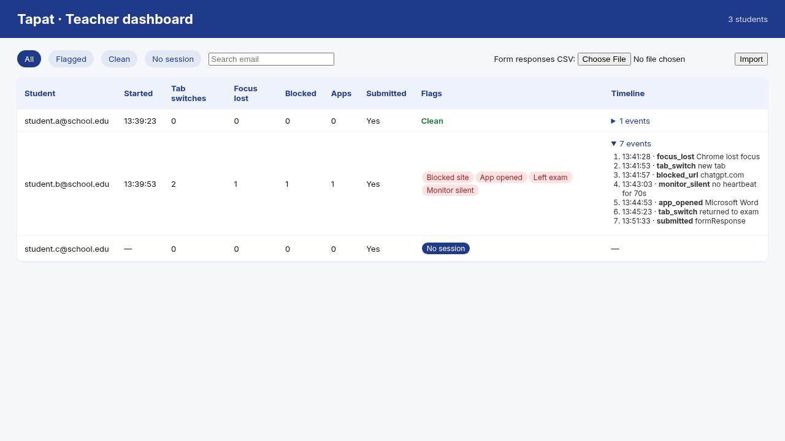
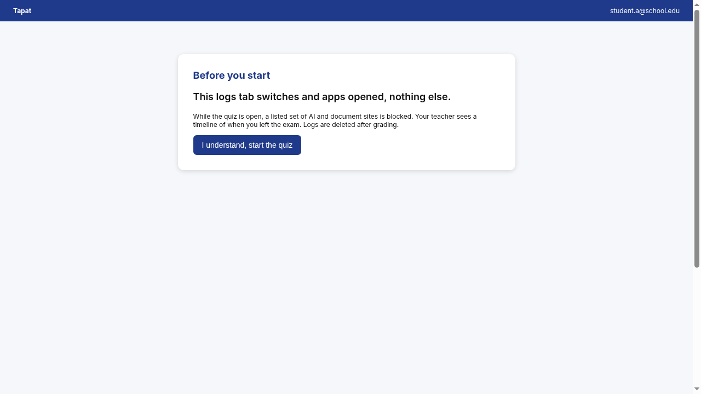
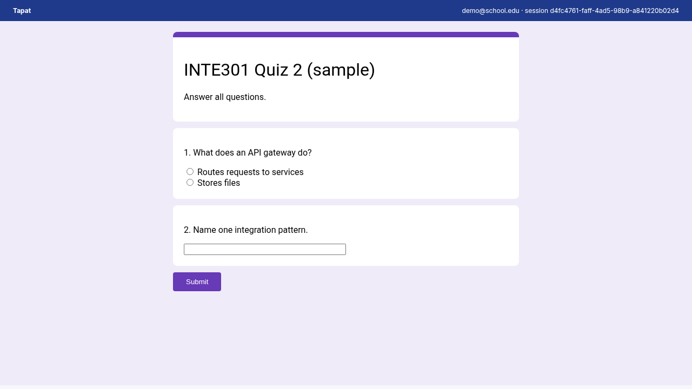
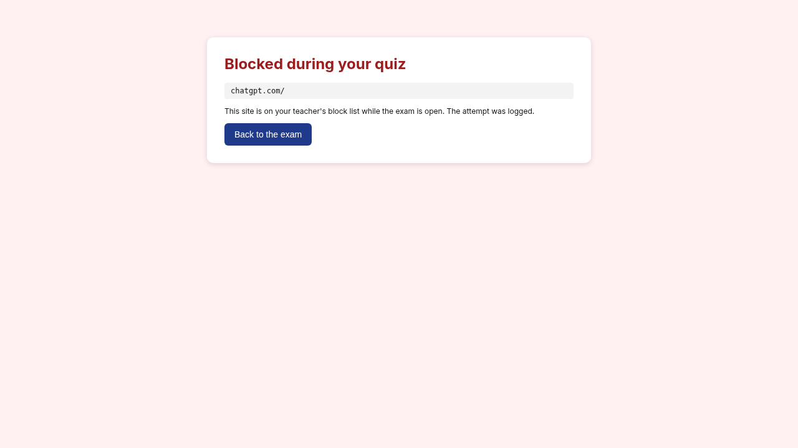

# Tapat

**Tapat** is an exam monitor for Google Forms quizzes. It blocks a listed set of AI and document sites while the quiz is open, logs when a student leaves the exam, and gives the teacher one dashboard to review every student afterward.

*Tapat* is Filipino for "honest."

## Overview

A student opens the quiz through the Tapat Chrome extension. The extension shows a consent screen, embeds the Google Form, blocks a listed set of AI and document sites, and logs tab switches and Chrome losing focus. An optional desktop watcher logs when Word, Notes, Preview or Acrobat comes to the front. Every event goes to a small teacher server, which shows one row per student on a dashboard. After the quiz, the teacher imports the Form's responses CSV, and anyone who submitted without Tapat running gets a **No session** flag.

## The problem

Online quizzes on Google Forms are easy to take with a second tab open. A student can ask ChatGPT, open their notes in Word, or read a PDF of the lesson, and the teacher sees only the final score. Project 1 asks for a system that addresses Google Forms quizzes being answered while opening webpages, ChatGPT, Word, notes and PDFs.

## Features

- **Consent first.** Before the quiz starts, the student sees: *"This logs tab switches and apps opened, nothing else."*
- **Site blocking.** Blocks a listed set of AI and document sites during the quiz: ChatGPT, Gemini, Claude, Word Online / office.com, Google Docs and any `.pdf` link. Blocked attempts are logged.
- **Leaving the exam.** Logs tab switches, new tabs and Chrome losing focus.
- **Desktop apps.** The watcher logs app names only, never window titles, and exits on its own when the Form is submitted.
- **Submit detection.** The session closes when the embedded Form reaches its `formResponse` page.
- **Heartbeat.** The extension checks in every 10 seconds. A gap over 25 seconds raises a **Monitor silent** flag.
- **No session flag.** For students who submitted the Form without Tapat running, found by importing the Form's responses CSV.
- **Teacher dashboard.** One row per student (by email), flag counts, a timeline of events, and filters for All, Flagged, Clean and No session.

## Architecture

| Part | Folder | Built with | Job |
|---|---|---|---|
| Chrome extension | `extension/` | Manifest V3, JavaScript | Consent, Form embed, blocking, tab/focus logging, submit detection, heartbeat |
| Desktop watcher | `watcher/` | Python | Logs which watched app is in front, by name only |
| Teacher server | `server/` | FastAPI, SQLite | Stores events, imports the Form CSV, serves the dashboard |

```
 Student's computer                                   Teacher
┌───────────────────────────────┐
│ Chrome + Tapat extension      │   POST /events   ┌──────────────────────┐
│  consent → embedded Form      │ ───────────────▶ │ Tapat server         │
│  block list · tab/focus log   │                  │ FastAPI + SQLite     │
│  heartbeat 10s · submit check │                  │                      │
└───────────────────────────────┘                  │ /dashboard  ◀──────── teacher
┌───────────────────────────────┐   POST /events   │ /import (Form CSV)   │
│ Desktop watcher (Python)      │ ───────────────▶ │ /sessions/{id}       │
│  front app name every 1s      │ ◀─── state ───── │                      │
└───────────────────────────────┘                  └──────────────────────┘
```

Every event has the same shape:

```json
{"session_id": "…", "student": "email", "type": "tab_switch | focus_lost | blocked_url | app_opened | heartbeat | submitted", "detail": "…", "ts": 1760250000.0}
```

## Setup

1. **In the Google Form, turn on Collect email addresses.** Tapat matches students by email (Settings → Responses → Collect email addresses).
2. **Start the server** (Python 3.10+):
   ```
   cd server
   ./run.sh --seed      # --seed loads three sample students
   ```
   The dashboard is at http://localhost:8000/dashboard.
3. **Load the extension:** open `chrome://extensions`, turn on Developer mode, click **Load unpacked** and pick the `extension/` folder.
4. **Optional, the watcher:** `python watcher/watcher.py --email you@school.edu --session <id shown on the exam page>`. On Windows, first run `pip install -r watcher/requirements.txt`.

## Usage

**Student**
1. Click the Tapat icon, enter your school email and paste the Form link.
2. Read the consent screen and start the quiz.
3. Answer and submit the Form as usual. Tapat stops when the response is recorded.

**Teacher**
1. Open the dashboard while the quiz runs to see each student's flags and timeline.
2. After the quiz, download the Form's responses as CSV and import it on the dashboard.
3. Filter by **Flagged** or **No session** to see who to follow up with.

Run the tests with `cd server && python -m pytest tests`.

## Screenshots

| | |
|---|---|
|  |  |
| Teacher dashboard | Consent screen |
|  |  |
| Exam page with the embedded Form | Block page for chatgpt.com |

The full set is in [`docs/screenshots`](docs/screenshots), and the documentation PDF is [`docs/Tapat_INTE301_Project1_Lazaro.pdf`](docs/Tapat_INTE301_Project1_Lazaro.pdf).

## Limitations

- It blocks a list, not all AI. A site that isn't on the list stays open, and a second device can't be seen at all.
- The watcher only runs if the student starts it, and it exits on submit.
- Students who decline the consent screen should be given an alternative, such as a supervised paper quiz.
- A flag is a reason to ask, not proof of cheating. The teacher decides.
- Logs are deleted after grading. Tapat stores emails and event types only, never page contents, keystrokes or window titles.

## Team

- Troy Lazaro
