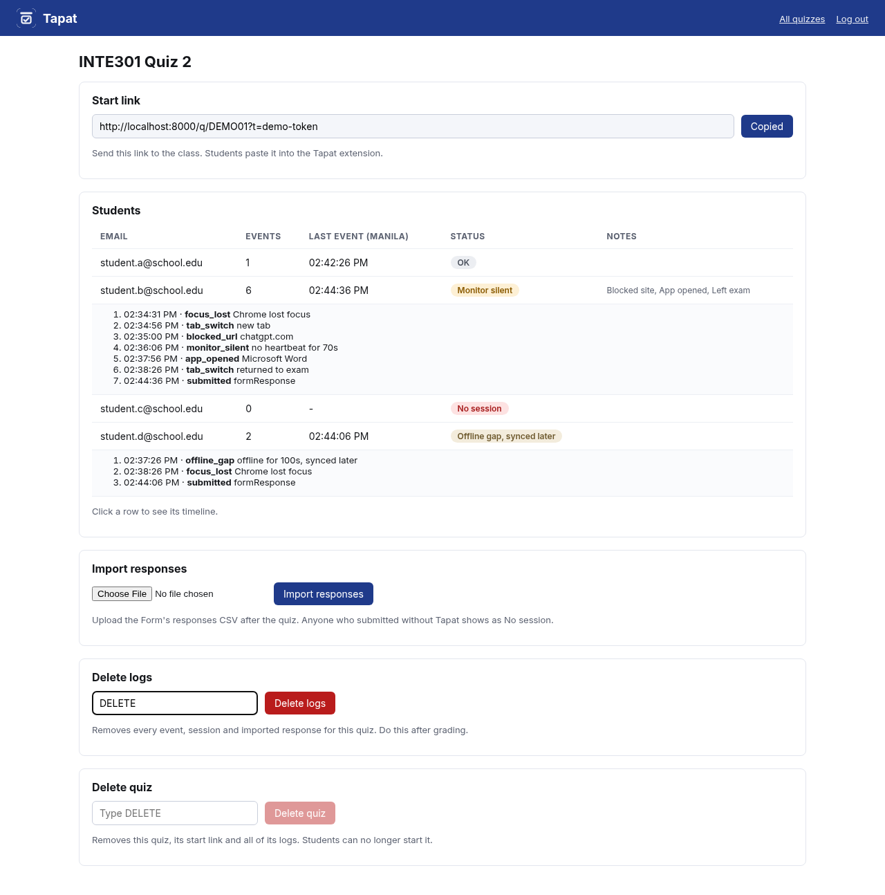
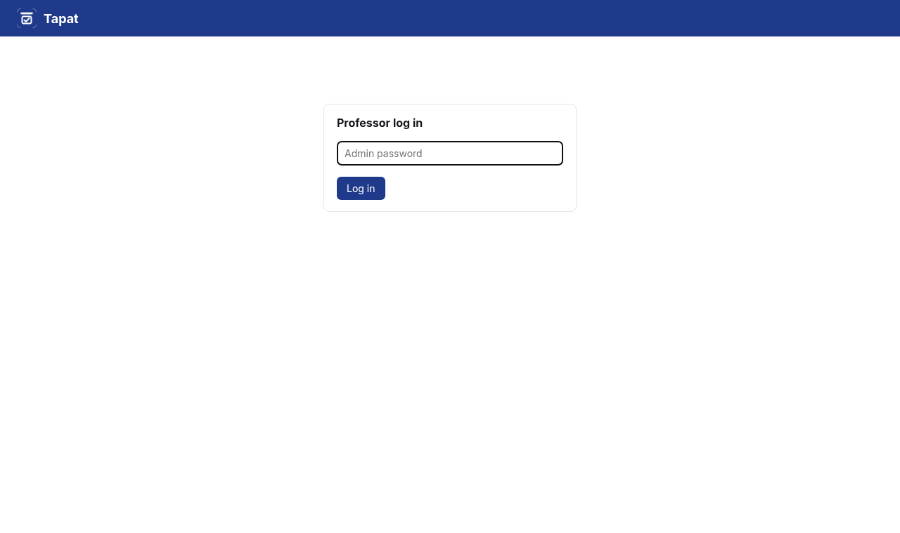

<p align="center"></p>

# Tapat

**Tapat** is an exam monitor for Google Forms quizzes. It blocks a listed set of sites while the quiz is open, logs when a student leaves the exam, and gives the professor one password-protected admin page to review every student afterward.

*Tapat* is Filipino for "honest."

## Overview

The professor creates a quiz on the Tapat admin page by pasting the Google Form link, then sends the class a start link. Each student pastes that link into the Tapat Chrome extension with their school email. The extension shows a consent screen, embeds the Google Form, blocks a listed set of sites, and logs tab switches and Chrome losing focus. An optional desktop watcher logs when Word, Notes, Preview or Acrobat comes to the front. Events go to the Tapat server, which shows one row per student. After the quiz, the professor imports the Form's responses CSV, and anyone who submitted without Tapat running is marked **No session**.

## The problem

Online quizzes on Google Forms are easy to take with a second tab open. A student can ask ChatGPT, open their notes in Word, or read a PDF of the lesson, and the professor sees only the final score. Project 1 asks for a system that addresses Google Forms quizzes being answered while opening webpages, ChatGPT, Word, notes and PDFs.

## Features

- **Consent first.** Before the quiz starts, the student sees: *"This logs tab switches and apps opened, nothing else."*
- **Site blocking.** Blocks a listed set of sites during the quiz: ChatGPT, Gemini, Claude, Word Online / office.com, Google Docs documents and any `.pdf` link. Google Forms itself is never blocked. Blocked attempts are logged.
- **Leaving the exam.** Logs tab switches, new tabs and Chrome losing focus.
- **Desktop apps.** The watcher logs app names only, never window titles, and exits on its own when the Form is submitted.
- **Submit detection.** The session closes when the embedded Form reaches its `formResponse` page.
- **Session tokens.** The start link carries a token for that quiz. Starting gives each student a session token bound to their email and the quiz, and every event must carry it.
- **Offline queue.** Every event is saved in the browser first, with its own time and a sequence number, and sent in order once the student is back online or the server wakes up. Resends are ignored by the server, so nothing is counted twice.
- **Heartbeat.** The extension checks in every 10 seconds. A gap over 25 seconds shows **Monitor silent**. If the gap was filled later by queued events, it shows **Offline gap, synced later** instead.
- **No session.** For students who submitted the Form without Tapat running, found by importing the Form's responses CSV.
- **Admin page.** Password login, one page per quiz with the start link, a row per student, Import responses, Delete logs and Delete quiz.

## Architecture

| Part | Folder | Built with | Job |
|---|---|---|---|
| Chrome extension | `extension/` | Manifest V3, JavaScript | Consent, Form embed, blocking, tab/focus logging, submit detection, heartbeat, offline queue |
| Desktop watcher | `watcher/` | Python | Logs which watched app is in front, by name only |
| Tapat server | `server/` | FastAPI, Postgres or SQLite | Quizzes, sessions, events, CSV import, admin page |

```
 Student's computer                                        Professor
┌───────────────────────────────┐
│ Chrome + Tapat extension      │  POST /api/start ┌──────────────────────┐
│  start link + email           │ ───────────────▶ │ Tapat server         │
│  consent → embedded Form      │  POST /events    │ FastAPI on Render    │
│  block list · tab/focus log   │ ───────────────▶ │                      │
│  heartbeat 10s · offline queue│                  │ /admin  ◀──────────── professor
└───────────────────────────────┘                  │                      │
┌───────────────────────────────┐  POST /events    │ Postgres on Neon     │
│ Desktop watcher (Python)      │ ───────────────▶ │ (SQLite locally)     │
│  front app name every 1s      │ ◀── state ────── │                      │
└───────────────────────────────┘                  └──────────────────────┘
```

Every event has the same shape. `ts` is the client time when it happened; the server adds the time it was received.

```json
{"session_id": "…", "session_token": "…", "seq": 12, "type": "tab_switch | focus_lost | blocked_url | app_opened | heartbeat | submitted", "detail": "…", "ts": 1760250000.0}
```

## Setup

1. **In the Google Form, turn on Collect email addresses.** Tapat matches students by email (Settings → Responses → Collect email addresses).
2. **Run the server locally** (Python 3.10+):
   ```
   cd server
   ADMIN_PASSWORD=choose-one ./run.sh --seed
   ```
   `--seed` adds a demo quiz. Without `ADMIN_PASSWORD`, `run.sh` makes a random password and prints it. The admin page is at http://localhost:8000/admin.
3. **Load the extension:** open `chrome://extensions`, turn on Developer mode, click **Load unpacked** and pick the `extension/` folder.
4. **Optional, the watcher:** on the exam page, click **Copy watcher command** and run it in a terminal from the `watcher/` folder. On Windows, first run `pip install -r watcher/requirements.txt`.

Tests: `cd server && python -m pytest tests` and `node --test extension/tests`.

## Deploy

Tapat is live at https://tapat-xrg5.onrender.com (admin page: https://tapat-xrg5.onrender.com/admin). It runs free on Render with a free Postgres database on Neon. Render's free disk is wiped on every restart, so the data lives in Neon. The click-by-click steps are in [`docs/deploy.md`](docs/deploy.md). In short:

1. Create a Neon project and copy its connection string.
2. In Render, create a **Blueprint** from this repo. It reads `render.yaml`.
3. Fill in `DATABASE_URL` (from Neon) and `ADMIN_PASSWORD` when Render asks. The password lives only in Render, never in the repo.
4. The extension already points at `https://tapat-xrg5.onrender.com`. If the service is ever recreated at a new address, update `extension/config.js` and `extension/manifest.json`.

## Usage

### Professor guide

1. In the Google Form, turn on **Collect email addresses**.
2. About a minute before the quiz, open https://tapat-xrg5.onrender.com/admin and log in. The free server sleeps when no one is using it, so the first load can take about a minute. That is normal. Once students start, their heartbeats keep it awake.
3. Under New quiz, type a title, paste the Google Form link and click **Create quiz**.
4. Click **Copy start link** and send the link to the class.
5. During the quiz, watch the Students table. Click a row to see that student's timeline.
6. After the quiz, download the Form's responses as CSV and upload it under Import responses with **Import responses**. Students who submitted without Tapat show as **No session**.
7. After grading, type `DELETE` and click **Delete logs**.
8. To remove a quiz entirely, type `DELETE` under Delete quiz and click **Delete quiz**. This removes the quiz, its start link and all of its logs.

Status chips: **OK** (gray), **Offline gap, synced later** (gray-amber), **Monitor silent** (amber), **No session** (red). Blocked sites, apps opened and leaving the exam are listed under Notes.

### Student

1. Click the Tapat icon, paste the start link, enter your school email and click **Open exam**. If it says "Server waking up…", wait; it can take a minute.
2. Read the consent screen and click **I understand, start the quiz**.
3. Answer and submit the Form as usual. If your wifi drops, keep going: Tapat shows "Offline, N events queued" and sends them when you are back online.

## Screenshots

| | |
|---|---|
|  |  |
| Admin quiz page | Admin login |
|  |  |
| Consent screen | Block page for chatgpt.com |

The full set is in [`docs/screenshots`](docs/screenshots), and the user manual PDF (professor guide, student guide, statuses, troubleshooting, deployment and source code) is [`docs/Tapat_INTE301_Project1_Lazaro.pdf`](docs/Tapat_INTE301_Project1_Lazaro.pdf). Its text is in [`docs/manual.md`](docs/manual.md).

## Limitations

- It blocks a list, not every site. A site that isn't on the list stays open, and a second device can't be seen at all.
- Each session has its own token, so events can't be faked for a classmate. It doesn't prove the student typed their own email. The responses CSV catches that mismatch afterward.
- Events queued offline are kept in the browser. If the student clears browser data or uninstalls the extension before reconnecting, those events are lost, and the gap shows as Monitor silent.
- The watcher only runs if the student starts it, and it exits on submit.
- Students who decline take the quiz on paper or in a proctored room.
- A flag is a reason to ask, not proof of cheating. The professor decides.

## Privacy

Events are stored on a hosted server (Render) with a database on Neon, and only the teacher can see them through a password-protected admin page. Tapat stores emails and event types only, never page contents, keystrokes or window titles. Logs are deleted after grading with **Delete logs**.

## Team

- Troy Lazaro
